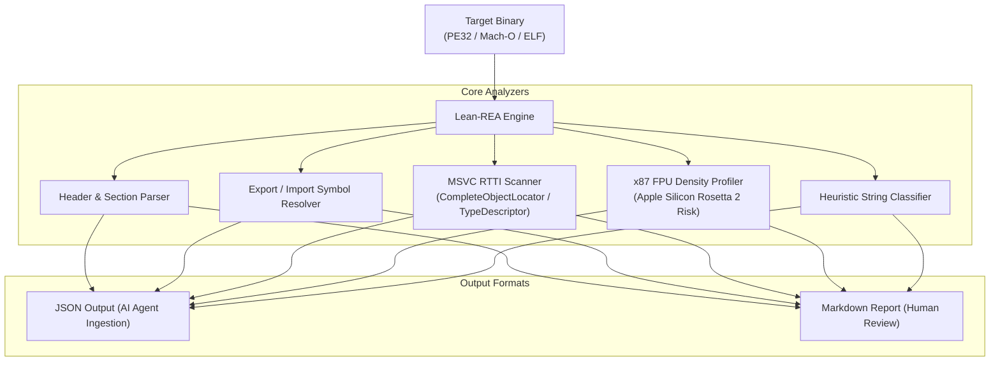

# Lean-REA (Reverse Engineer Anything)

[](LICENSE)
[](https://python.org)
[](https://github.com)

Lightweight, zero-dependency multi-format binary triage and reverse engineering CLI tool engineered for automated agent pipelines and low-overhead static inspection.

---

## Architecture



---

## Key Features

1. **Multi-Format Format Detection**: Parses PE32/PE32+ (Windows), Mach-O 32/64-bit (macOS / iOS), and ELF 32/64-bit (Linux) headers with pure Python standard library.
2. **Rosetta 2 x87 FPU Density Profiler**: Identifies legacy 80-bit x87 floating-point instruction densities (`FLD`, `FMUL`, `FSTP`) that cause microcode emulation bottlenecks on Apple Silicon macOS CrossOver/Wine.
3. **MSVC RTTI vtable Recovery**: Reconstructs C++ class hierarchies by scanning `.rdata` for `CompleteObjectLocator` and mangled `.?AV...@@` type descriptors.
4. **Agent-Ready JSON & Markdown**: Directly ingestible into automated LLM triage pipelines and incident response workflows.

---

## Installation & CLI Usage

### Standalone Usage
```bash
# Direct single-file invocation:
python3 lean_rea.py path/to/binary --format markdown

# Machine-readable JSON output for AI agents:
python3 lean_rea.py path/to/binary --format json > report.json
```

### Editable pip install
```bash
pip install -e .
lean-rea --help
```

### CLI Options
```text
usage: lean-rea [-h] [--format {markdown,json}] [--out OUT] binary

positional arguments:
  binary                Target binary path (PE, Mach-O, ELF)

options:
  -h, --help            Show this help message and exit
  --format {markdown,json}
                        Output format (default: markdown)
  --out OUT, -o OUT     Write report to file
```

---

## Русская документация

Быстрый, автономный инструмент статического анализа и реверс-инжиниринга бинарных файлов без тяжелых внешних зависимостей.

### Возможности:
- **Поддержка форматов**: PE32/PE32+ (Windows), Mach-O (macOS), ELF (Linux).
- **Профилирование x87 FPU**: Детекция плотности инструкций x87 для оценки риска падения производительности в Apple Silicon Rosetta 2.
- **Восстановление RTTI**: Сканирование таблиц виртуальных методов MSVC и извлечение имен классов C++.
- **Форматы вывода**: Машиночитаемый JSON для LLM-агентов и форматированный Markdown.

---

## License

This project is licensed under the MIT License - see the [LICENSE](LICENSE) file for details.

Developed & Maintained by **spartak** (2026).
